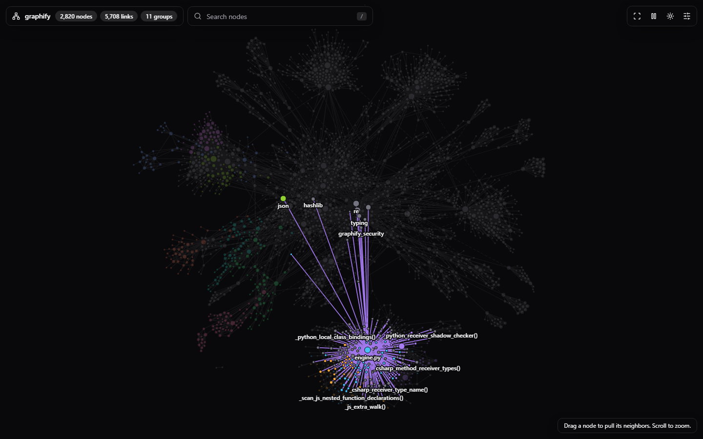

# agents-md-kit

[](https://github.com/iChicoRito/agents-md-kit/actions/workflows/test.yml) [](LICENSE)

A small, scalable instruction setup for AI coding agents. One command adds it to any project. Pick the version for the agents you use: Claude Code, Codex (and other agents), or both.


- One main instruction file, kept under 200 lines.
- Working rules, one topic per file.
- `docs/` for architecture, API, database and guides. Agents open these only when a task needs them.
- Works with [graphify](https://pypi.org/project/graphifyy/): when a project has a knowledge graph, the AI queries it instead of reading the whole codebase. Optional, and a rule file tells the agent how.

New here? Read the **[guide](GUIDE.md)**: what every file does, and how to use the kit on a new or existing project.

## Pick your version

| Version | For | Main file | Folder |
|---|---|---|---|
| `claude` | Claude Code only | `CLAUDE.md` | `.claude/` |
| `agents` | Codex and other agents only | `AGENTS.md` | `.agents/` |
| `both` | Claude Code and Codex in the same project | `CLAUDE.md`, with `AGENTS.md` pointing to it | `.claude/` and `.agents/` |

The installer asks two questions:

1. **Which agents?** Claude Code, Codex / other agents, or both.
2. **New or existing project?** It suggests the answer from your folder (empty folder = new).
   - **Existing:** it adds `PROMPT.md`, a ready prompt that makes your AI fill the placeholders from your code.
   - **New:** it asks if you want `PROMPT.md` for later (default: no). You fill the files as you build.

If it cannot ask (for example in a script), it uses `both` and detects new or existing from the folder.

## Install

Open a terminal **in your project folder** and run one command. It asks which version you want.

Pick each answer with the arrow keys and Enter (or press its number). Terminals without arrow-key support get numbered questions to type instead.

**Windows (PowerShell)**

```powershell
& ([scriptblock]::Create((irm https://raw.githubusercontent.com/iChicoRito/agents-md-kit/main/install.ps1)))
```

**Mac, Linux, Git Bash**

```bash
curl -fsSL https://raw.githubusercontent.com/iChicoRito/agents-md-kit/main/install.sh | bash
```

**Skip the questions** with options: `--for claude|agents|both`, `--project new|existing`, `--prompt yes|no` (PowerShell: `-For`, `-Project`, `-Prompt`):

```powershell
& ([scriptblock]::Create((irm https://raw.githubusercontent.com/iChicoRito/agents-md-kit/main/install.ps1))) -For claude -Project existing
```

```bash
curl -fsSL https://raw.githubusercontent.com/iChicoRito/agents-md-kit/main/install.sh | bash -s -- --for claude --project existing
```

**Install into another folder** by adding the path at the end:

```powershell
& ([scriptblock]::Create((irm https://raw.githubusercontent.com/iChicoRito/agents-md-kit/main/install.ps1))) -For both "C:\path\to\project"
```

```bash
curl -fsSL https://raw.githubusercontent.com/iChicoRito/agents-md-kit/main/install.sh | bash -s -- --for both "path/to/project"
```

No git needed. The installer downloads the template and copies it in.

**Prefer to read the script before running it?** Good habit. Download it, read it, then run it:

```bash
curl -fsSL https://raw.githubusercontent.com/iChicoRito/agents-md-kit/main/install.sh -o install.sh
less install.sh          # read it (q to quit)
bash install.sh
```

```powershell
irm https://raw.githubusercontent.com/iChicoRito/agents-md-kit/main/install.ps1 -OutFile install.ps1
notepad install.ps1      # read it
powershell -ExecutionPolicy Bypass -File .\install.ps1
```

To be sure the script cannot change after you read it, use a release instead of `main`: replace `main` in the URL with a tag such as `v1.2.0`. All tags: [Releases](https://github.com/iChicoRito/agents-md-kit/releases).

See all options: add `--help` (Bash) or `-Help` (PowerShell) to the command, or see [All commands](#all-commands).

Prefer typed answers? Set `AGENTS_MD_KIT_UI=plain` before running. `NO_COLOR=1` turns colors off.

**Safe for existing projects**

- It never overwrites a file. Files that already exist are skipped and listed, so you can merge them by hand.
- It keeps an existing `.gitignore` and adds only the missing lines at the end.
- Running it again changes nothing.
- It asks before it touches graphify. At the end it offers to install the official [graphify](https://pypi.org/project/graphifyy/) if it is missing, then offers to build the code graph. Both default to No. In scripts there is no question: nothing is installed or built unless you pass `--graphify yes`.
- Not sure? Add `--dry-run` (Bash) or `-DryRun` (PowerShell) first. It shows what would be added, merged or skipped, and changes nothing.

**Update a project that already has the kit**

Add `--update` (Bash) or `-Update` (PowerShell) to the install command:

```powershell
& ([scriptblock]::Create((irm https://raw.githubusercontent.com/iChicoRito/agents-md-kit/main/install.ps1))) -Update
```

```bash
curl -fsSL https://raw.githubusercontent.com/iChicoRito/agents-md-kit/main/install.sh | bash -s -- --update
```

- Kit files you deleted are added back.
- A kit file that changed (in the kit or by you) is not touched. The newer kit version is saved next to it as `<file>.kit-new`, for example `CLAUDE.md.kit-new`.
- Merge what you want from each `.kit-new` file, then delete it. Or tell your AI: *Merge every \*.kit-new file into the file next to it. Keep my project details. Then delete the .kit-new files.*
- `*.kit-new` is in the kit's `.gitignore`, so these files are not committed by mistake.

**Install a fixed version**

The installer shows its version in the welcome box. To install a released version instead of the latest, add `--version` (Bash) or `-Version` (PowerShell):

```bash
curl -fsSL https://raw.githubusercontent.com/iChicoRito/agents-md-kit/main/install.sh | bash -s -- --version 1.0.0
```

```powershell
& ([scriptblock]::Create((irm https://raw.githubusercontent.com/iChicoRito/agents-md-kit/main/install.ps1))) -Version 1.0.0
```

All versions and what changed: [Releases](https://github.com/iChicoRito/agents-md-kit/releases) and [CHANGELOG.md](CHANGELOG.md).

## Graph view

When a project has a graphify graph, the kit builds an interactive map of it: `graphify-out/graph-view.html`. Open it in any browser. It works offline.



- It looks and moves like Obsidian's graph view. Drag a node and the nodes linked to it follow along the lines.
- Hover a node to light up its neighbors. Click it for details and a list of its connections.
- Press `/` to search. Hide groups, and tune the forces (center, repel, link) in the settings panel. Dark and light themes.

The installer builds the view right after it builds the graph. The file name is `graph-view.html` on purpose: graphify owns `graph.html` and rewrites it on every `graphify update .`, so a view written there would be lost. With its own name, this view survives graphify updates, hooks and rebuilds. Rebuild it any time with `agents-md-kit --graph-view` (PowerShell: `agents-md-kit -GraphView`). It needs Python 3.8 or newer, which graphify needs anyway.

### Force your design to be the only view

`--graph-view` keeps two pages side by side: graphify's `graph.html` and the kit's `graph-view.html`. If you want your design to be the only HTML graph, and want to edit it, run once:

```
agents-md-kit --force-view
```

```
agents-md-kit -ForceView
```

That command:

- copies the viewer into `tools/graph-view/` (`template.html`, `graph_view.py`, `refresh.py`, vendor), so the design is yours and the kit never overwrites your edits;
- writes `viz_node_limit=0` to `.graphifyrc`, so graphify's git hooks stop rendering `graph.html`;
- removes any existing `graphify-out/graph.html`, leaving one HTML view;
- builds the view from your copy.

From then on, refresh with `python tools/graph-view/refresh.py`. It updates the graph with `GRAPHIFY_VIZ_NODE_LIMIT=0` (the only setting a manual `graphify update .` honors) and rebuilds the view from your template. Change the look in `tools/graph-view/template.html`, then `python tools/graph-view/refresh.py --no-graph`.

Coupling worth knowing: the cache, queries, report and hooks all read `graph.json`, and nothing reads either HTML file, so removing graphify's page changes no other feature. `.graphifyrc` only affects graphify's **git hooks**; a bare `graphify update .` in your own shell still renders `graph.html`, which is why `refresh.py` sets the environment variable itself. If a `graph.html` appears, it came from a bare update: delete it, or run `refresh.py`, which removes it.

## What you get

**`claude`: Claude Code only**

```text
CLAUDE.md          main instructions
PROMPT.md          prompt that makes your AI fill the placeholders (existing projects, or new if you choose)
.gitignore         keeps personal Claude files out of git
.claude/
  rules/           how Claude should work (loaded automatically)
  skills/          skills made only for this project (loaded automatically)
  hooks/           line-limit check
  settings.json    plugins, hook, no AI author lines on commits
docs/              architecture, API, database, guides, decisions
```

**`agents`: Codex and other agents only**

```text
AGENTS.md          main instructions
PROMPT.md          prompt that makes your AI fill the placeholders (existing projects, or new if you choose)
.agents/
  rules/           how agents should work (AGENTS.md lists them)
  skills/          skills made only for this project
docs/              architecture, API, database, guides, decisions
```

**`both`: Claude Code and Codex**

```text
CLAUDE.md          main instructions (all agents)
AGENTS.md          pointer: tells Codex to read CLAUDE.md
PROMPT.md          prompt that makes your AI fill the placeholders (existing projects, or new if you choose)
.gitignore         keeps personal Claude files out of git
.claude/
  rules/           how agents should work
  skills/          skills for Claude Code only
  hooks/           line-limit check
  settings.json    plugins, hook, no AI author lines on commits
.agents/
  skills/          skills made only for this project (all agents)
docs/              architecture, API, database, guides, decisions
```

## Requirements

- Claude Code, Codex, or both.
- Node.js, for `npx skills add`. The line-limit hook in Claude Code also uses it, and is skipped quietly without it.
- Skills. See `docs/guides/setup.md` after install:
  - `claude` and `both`: six plugins (Superpowers, Ponytail, Caveman, mattpocock-skills, ux-ui-agent-skills, unslop-ui) install when you open the project in Claude Code. The Caveman skills and design skills are installed by hand with `npx skills add`.
  - `agents`: all skills are installed with `npx skills add`.
- Optional: the installer can install or update the primary skills (Superpowers, Ponytail, Caveman) from their official repos. It asks first (default No), or use `--skills yes|no`. Claude Code gets the plugins (needs the `claude` command), Codex gets the plain skills (needs Node.js).
- Optional: graphify, for a queryable knowledge graph of your code (`uv tool install graphifyy`). Steps in `docs/guides/setup.md`.

## After install

1. Fill the `[PLACEHOLDERS]` in the main file (`CLAUDE.md`, or `AGENTS.md` for the `agents` version) and in `docs/`. For an existing project (or a new one where you chose it), the installer adds `PROMPT.md` with the ready prompt for your version. Tell your AI agent:
   > Read PROMPT.md and do what it says.

   It reads your code and fills everything in. The same prompts are online in [PROMPTS.md](PROMPTS.md):
   - [Claude Code only](PROMPTS.md#claude-code-only-claude)
   - [Codex or other agents](PROMPTS.md#codex-or-other-agents-agents)
   - [Both](PROMPTS.md#both-both)
2. In Claude Code, run `/memory` and `/skills` to check what loads.

Using it on an existing project? See [GUIDE.md](GUIDE.md#use-it-on-an-existing-project) for how to merge.

## All commands

Bash (Mac, Linux, Git Bash) uses `--option`. PowerShell uses `-Option`. **Options are not commands on their own:** type them after the install command (or after `agents-md-kit`, see [short command](#optional-short-command)), for example `agents-md-kit -For claude`. Options can be combined, and the folder path goes at the end.

| Goal | Bash: add to the command | PowerShell: add to the command |
|---|---|---|
| Install, answering the questions | `curl -fsSL https://raw.githubusercontent.com/iChicoRito/agents-md-kit/main/install.sh \| bash` | `& ([scriptblock]::Create((irm https://raw.githubusercontent.com/iChicoRito/agents-md-kit/main/install.ps1)))` |
| Claude Code only | `--for claude` | `-For claude` |
| Codex / other agents only | `--for agents` | `-For agents` |
| Claude Code and Codex | `--for both` | `-For both` |
| New or empty project | `--project new` | `-Project new` |
| Existing project | `--project existing` | `-Project existing` |
| Add `PROMPT.md` or not (new projects) | `--prompt yes` / `--prompt no` | `-Prompt yes` / `-Prompt no` |
| Update a project that has the kit | `--update` | `-Update` |
| Install a released version | `--version 1.0.1` | `-Version 1.0.1` |
| Install into another folder | `... "path/to/project"` | `... "C:\path\to\project"` |
| Preview only, change nothing | `--dry-run` | `-DryRun` |
| Add the short command `agents-md-kit` | `--add-command` | `-AddCommand` |
| List the `[PLACEHOLDERS]` still left | `--check` | `-Check` |
| Build the interactive graph view (`graphify-out/graph-view.html`) | `--graph-view` | `-GraphView` |
| Force your design to be the only HTML graph | `--force-view` | `-ForceView` |
| graphify without being asked: install if missing and build the graph, or skip it | `--graphify yes` / `--graphify no` | `-Graphify yes` / `-Graphify no` |
| Show help | `--help` | `-Help` |
| Typed answers instead of arrow keys | `AGENTS_MD_KIT_UI=plain` before `bash` | `$env:AGENTS_MD_KIT_UI = "plain"` first |
| No colors | `NO_COLOR=1` before `bash` | `$env:NO_COLOR = "1"` first |

With Bash, options go after `bash -s --`:

```bash
curl -fsSL https://raw.githubusercontent.com/iChicoRito/agents-md-kit/main/install.sh | bash -s -- --for claude --project existing
```

With PowerShell, options go after the last `)`:

```powershell
& ([scriptblock]::Create((irm https://raw.githubusercontent.com/iChicoRito/agents-md-kit/main/install.ps1))) -For claude -Project existing
```

## Optional: short command

Add an `agents-md-kit` command so you can type one word in any project. Options pass through, for example `agents-md-kit --for claude`.

**Easiest:** let the installer add it for you. Run once, then open a new terminal:

```powershell
& ([scriptblock]::Create((irm https://raw.githubusercontent.com/iChicoRito/agents-md-kit/main/install.ps1))) -AddCommand
```

```bash
curl -fsSL https://raw.githubusercontent.com/iChicoRito/agents-md-kit/main/install.sh | bash -s -- --add-command
```

PowerShell adds it to your profile (`$PROFILE`). Bash adds it to `~/.zshrc` when your shell is zsh, otherwise to `~/.bashrc`. Running it again adds nothing.

**By hand:** PowerShell (run `notepad $PROFILE` and add):

```powershell
function agents-md-kit { & ([scriptblock]::Create((irm https://raw.githubusercontent.com/iChicoRito/agents-md-kit/main/install.ps1))) @args }
```

Bash (add to `~/.bashrc`):

```bash
agents-md-kit() { curl -fsSL https://raw.githubusercontent.com/iChicoRito/agents-md-kit/main/install.sh | bash -s -- "$@"; }
```

PowerShell uses `-For claude`; Bash uses `--for claude`.

Open a new terminal after adding it, then:

| Goal | Bash | PowerShell |
|---|---|---|
| Install, answering the questions | `agents-md-kit` | `agents-md-kit` |
| Claude Code, existing project | `agents-md-kit --for claude --project existing` | `agents-md-kit -For claude -Project existing` |
| Update a project that has the kit | `agents-md-kit --update` | `agents-md-kit -Update` |
| Install a released version | `agents-md-kit --version 1.0.1` | `agents-md-kit -Version 1.0.1` |
| Install into another folder | `agents-md-kit --for both "path/to/project"` | `agents-md-kit -For both "C:\path\to\project"` |
| Preview only, change nothing | `agents-md-kit --dry-run` | `agents-md-kit -DryRun` |
| List the placeholders still left | `agents-md-kit --check` | `agents-md-kit -Check` |
| Build the interactive graph view | `agents-md-kit --graph-view` | `agents-md-kit -GraphView` |
| Force your design to be the only HTML graph | `agents-md-kit --force-view` | `agents-md-kit -ForceView` |
| Show help | `agents-md-kit --help` | `agents-md-kit -Help` |

## Contributing

Found a bug or have an idea? Open an [issue](https://github.com/iChicoRito/agents-md-kit/issues/new/choose). Want to change the kit? See [CONTRIBUTING.md](CONTRIBUTING.md).

## License

MIT. See [LICENSE](LICENSE). Use it, change it and share it freely.
